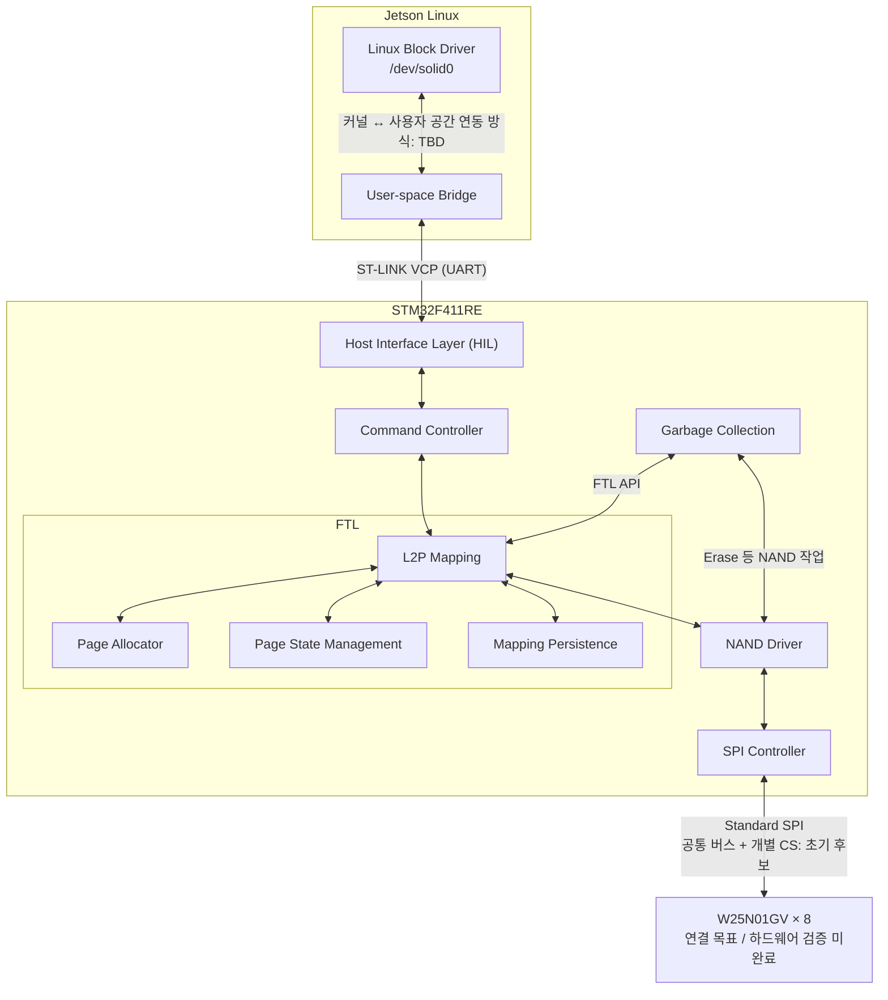
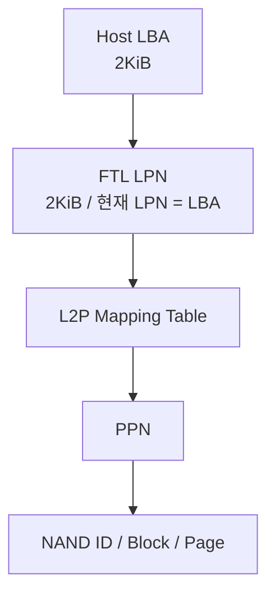

# SOLID 시스템 아키텍처

## 1. 문서 상태와 적용 기준

이 문서는 SOLID의 현재 설계 기준을 정리합니다. 구현 완료나 하드웨어 검증 결과를 의미하지 않습니다.

| 표시 | 의미 |
|---|---|
| 확정 기준 | 전달된 요구사항에서 합의한 개발 기준 |
| 초기 권장 / 후보 | 검증 및 팀 검토를 거쳐 선택할 제안 |
| TBD | 구현 전 결정하거나 실험으로 확인해야 하는 사항 |
| 확장 후보 | 초기 개발 범위 이후 검토할 기능 |

데이터 단위와 시스템 경계는 이 문서를 기준으로 합니다. FTL·GC 연동은 [FTL / GC API](ftl-gc-api.md), Host 통신은 [통신 프로토콜](protocol.md)을 함께 참조합니다. API의 정확한 C 시그니처와 통신 프레임의 바이트 배치는 아직 TBD입니다.

## 2. 프로젝트 개요

- **프로젝트명:** SOLID
- **목표:** Jetson Linux에서 인식되는 사용자 정의 블록 저장장치를 만들고, STM32F411RE가 외부 SPI NAND Flash를 제어합니다.
- **구현 주제:** FTL, Out-of-place Update, Garbage Collection, Bad Block Management, Mapping Persistence.
- **최종 검증 목표:** Linux 블록 장치에 파일 저장 → 재읽기 및 데이터 일치 확인 → 정상 종료 → 재시작 → 파일시스템 재마운트 및 데이터 확인.

파일시스템 종류, 포맷 옵션, 정상 종료 절차의 세부 명령은 TBD입니다. 정상 종료 후 복원을 초기 목표로 하며, 강제 전원 차단 복구는 확장 후보입니다.

## 3. 전체 시스템 구조



화살표는 논리적 호출·데이터 경로이며, 스레드나 병렬 실행을 뜻하지 않습니다.

| 계층 | 책임 | 구현 경계 / 미정 사항 |
|---|---|---|
| Linux Block Driver | `/dev/solid0` 등록, 블록 요청 접수, 정렬·용량 검증, 요청 완료 처리 | Jetson 커널 버전 및 Bridge 연동 방식 TBD |
| User-space Bridge | Host 요청을 UART 프로토콜로 변환, 응답 전달 | UART 설정·프레임·오류 전달 방식 TBD |
| HIL | Host 명령 해석·검증, FTL에 요청 전달, 응답 구성 | Command Controller를 통한 구체적 호출 구조 TBD |
| Command Controller | 명령 실행 순서와 공유 Page Buffer 사용 조정 | HIL과의 내부 API 및 GC 실행 시점 TBD |
| FTL | LPN→PPN 매핑, Page 할당·상태, 갱신 정책, Mapping Persistence | Mapping Table의 최종 수정 권한 보유 |
| GC | Victim 선택, 유효 Page 이동, Block 회수 | Mapping 변경은 FTL API 사용 |
| NAND Driver | NAND 명령 실행, Status·ECC·오류 확인, Bad Block Marker 검사 | 명령별 API와 오류 형식 TBD |
| SPI Controller | SPI 전송과 CS 제어 | 핀·Prescaler·전송 방식 TBD |

## 4. 하드웨어 사양

### 4.1 MCU

| 항목 | 설계 대상 |
|---|---|
| MCU | STM32F411RE |
| 개발보드 | NUCLEO-F411RE |
| CPU | Cortex-M4 |
| SRAM | 128KiB |
| 내부 Flash | 512KiB |

MCU 메모리와 코어 사양은 [ST STM32F411RE 제품 정보](https://www.st.com/en/microcontrollers-microprocessors/stm32f411re.html)를 참조합니다. 보드의 VCP 지원은 [ST NUCLEO-F411RE 제품 정보](https://www.st.com/en/evaluation-tools/nucleo-f411re.html)를 참조합니다.

### 4.2 NAND

| 항목 | 설계 대상 / 지오메트리 |
|---|---|
| 계열 | Winbond W25N01GV |
| 인터페이스 | SPI NAND |
| 칩당 Data 용량 | 1Gbit = 128MiB |
| 연결 개수 | 총 8개 목표 |
| 총 Raw Data Capacity | 1GiB, Spare 제외·불량/예약 영역 차감 전 |
| Page | 2,048B Data + 64B Spare |
| Block | 64 Pages |
| Block Data Capacity | 128KiB |
| 칩당 Block 수 | 1,024 |
| ECC | 내장 ECC 지원 |
| Bad Block | 초기 Bad Block이 존재할 수 있음 |

계열의 SPI 인터페이스, Page 크기와 내장 ECC 지원은 [Winbond W25N-GV 제품 정보](https://www.winbond.com/hq/product/code-storage-flash/qspi-nand/w25n-gv/index.html?__locale=en)를 참조합니다. 실제 부품의 전체 품번과 적용 Datasheet 리비전은 TBD이며, 부품 선정 시 지오메트리와 명령·Status 규격을 대조합니다.

NAND 동작 기준:

- Read와 Program은 Page 단위, Erase는 Block 단위로 처리합니다.
- Program/Erase 완료 여부와 실패 여부는 NAND Status Register로 확인합니다.
- 초기 Bad Block Marker는 해당 Block을 Erase하기 전에 검사합니다.
- Spare는 Host 데이터 용량에 포함하지 않습니다. ECC·Bad Block Marker와 충돌하지 않는 메타데이터 배치는 TBD입니다.
- 초기 Bad Block 및 운용 중 실패 Block을 할당 대상에서 제외하는 정책을 마련합니다. 상세 책임 분담과 영속화 형식은 TBD입니다.

8개 NAND의 **공통 SPI 버스 + 개별 GPIO CS** 구성을 초기 후보로 둡니다. SPI 핀, CS 핀, 모듈 배선, 전원 및 신호 품질 검증은 TBD입니다. 8칩 연결과 실제 동작 검증은 완료되지 않았습니다.

## 5. SPI 인터페이스

다음은 **초기 권장 구성**이며, 최종 하드웨어 설정은 검증 후 결정합니다.

| 항목 | 초기 권장값 |
|---|---|
| STM32 역할 | SPI Master |
| NAND 역할 | SPI Slave |
| 전송 방식 | Standard SPI (Single SPI) |
| Data Frame | 8bit |
| SPI Mode | Mode 0 |
| Bit Order | MSB First |
| 초기 SPI Clock | 1MHz 권장, 검증 후 조정 |
| Chip Select | NAND별 개별 GPIO CS 제어 |

SPI 주파수는 STM32의 주변장치 클럭과 Prescaler로 설정합니다. 실제 클럭 트리·Prescaler·실측 주파수는 TBD입니다.

**SPI 전송 완료와 NAND 내부 Program/Erase 완료는 별도입니다.** 전송이 끝나도 NAND 내부 작업이 진행 중일 수 있으므로, NAND Driver가 Status를 확인한 뒤 상위 계층에 완료를 전달합니다. Polling 간격과 명령별 Timeout은 TBD입니다.

## 6. 데이터 처리 단위

다음은 **확정 기준**입니다.

| 항목 | 설계 기준 |
|---|---|
| Host 논리 블록 | 2KiB |
| HIL LBA 단위 | 2KiB |
| FTL LPN 단위 | 2KiB |
| NAND Data Page | 2KiB |
| 초기 READ/WRITE 데이터 Payload | 2,048B |
| 초기 요청 처리 | 한 번에 요청 1개 |
| 초기 READ/WRITE COUNT | 1, Stop-and-Wait |
| STM32 SRAM Page Buffer | 2,048B × 1개 |
| NAND Program | Page 단위 |
| NAND Erase | Block 단위, Data 128KiB |

READ 데이터는 STM32→Host, WRITE 데이터는 Host→STM32 방향으로 전달됩니다. 헤더·상태 정보는 2,048B 데이터 Payload와 별개이며, 전체 프레임 길이는 TBD입니다.

- 초기에는 512B Partial Write를 지원하지 않습니다.
- Page Buffer 1개를 READ와 WRITE에 재사용합니다. 요청 처리 중 다음 수신이나 다른 작업이 버퍼를 덮어쓰지 않아야 합니다.
- UART 수신 상태, 명령 헤더 및 제어 자료구조는 별도 메모리를 사용할 수 있습니다.
- GC의 유효 Page 이동에도 데이터 버퍼가 필요합니다. 공유 버퍼의 소유권과 GC 실행 시점은 [FTL / GC API](ftl-gc-api.md)에 검토안으로 정리합니다.

## 7. 주소 체계와 Host 요청 변환



현재 설계는 `LPN = LBA`입니다. LPN은 논리 주소이고 PPN은 물리 주소이므로, Out-of-place Update와 GC 이후 같은 LPN의 PPN이 바뀔 수 있습니다. PPN의 정수 인코딩·비트 배치·관리 영역 번호 체계는 TBD입니다.

Linux 블록 계층의 요청 섹터 번호는 일반적으로 512B 단위입니다. Host는 시작 위치와 길이를 검증한 뒤 2KiB 요청으로 변환합니다. Linux 요청의 위치와 길이 접근 방식은 [Linux block request 정의](https://raw.githubusercontent.com/torvalds/linux/master/include/linux/blk-mq.h)를 참조하되, 실제 API는 대상 Jetson 커널 버전에 맞춰 확인합니다.

| 변환 / 검증 | 기준 |
|---|---|
| 시작 위치 정렬 | `Linux sector number % 4 = 0` |
| 요청 길이 정렬 | `byte length % 2048 = 0` |
| Protocol LBA | `Linux sector number / 4` |
| 분할 요청 수 | `byte length / 2048` |
| 2KiB 블록 1개 | 512B sector 4개 |
| 범위 검증 | 시작 LBA와 요청 블록 수가 실제 노출 용량 내에 있어야 함 |

여러 2KiB 블록을 포함하는 Linux 요청은 Host 측에서 2KiB 요청으로 나누고, 각 응답을 받은 뒤 다음 요청을 처리합니다. 분할·정렬 검증을 Driver와 Bridge 중 어디서 수행할지는 TBD입니다. 장치의 Linux 논리 블록 크기는 2KiB로 반영해야 하며, 커널 설정 API는 TBD입니다.

변환 예: 시작 sector 8, 길이 4,096B → Protocol LBA 2의 요청과 LBA 3의 요청으로 분할합니다. 정렬되지 않은 요청을 정수 나눗셈으로 잘라 처리하지 않습니다.

## 8. 초기 저장 용량과 SRAM 예산

다음은 **초기 검증용 제안값**입니다. 최종 확정된 용량 또는 하드웨어 배치 정책이 아닙니다.

| 항목 | 제안값 | 산출 |
|---|---|---|
| 논리 노출 용량 | 16MiB | 8,192 × 2KiB |
| FTL 물리 관리 영역 | 24MiB | 12,288 × 2KiB |
| 논리 Page 수 | 8,192 | L2P 항목 수 후보 |
| 물리 관리 Page 수 | 12,288 | 지오메트리상 192 Blocks |

불량 Block, 메타데이터, GC 예약 Block을 고려해 실제 가용 공간을 검증해야 합니다. 24MiB 영역에 예약·메타데이터 공간을 포함할지, 별도 영역으로 둘지와 칩별 배치는 TBD입니다. 위 숫자의 차이만으로 GC 가능 공간을 보장하지 않습니다.

**메모리 검토용 산술 예시:** L2P 항목을 4B로 표현한다고 가정하면 초기 논리 영역의 테이블은 32KiB입니다. 8칩 Raw 전체 1GiB를 2KiB 단위로 매핑하면 524,288항목이며 같은 가정에서 2MiB가 필요해 SRAM 128KiB를 초과합니다. 이는 타입을 4B로 확정한 것이 아닙니다.

L2P, Page State, 역방향 조회, Block 관리 정보, UART 제어 정보, 스택과 Page Buffer를 합산한 SRAM 예산은 TBD입니다. 8칩 전체 용량으로 확대할 때의 Mapping 구조는 별도 검토가 필요합니다.

## 9. NAND 8개 사용 목적

여러 NAND 칩을 하나의 논리 저장장치로 통합하는 SSD Controller 구조를 모사합니다.

| 구현·검증 목표 | 내용 |
|---|---|
| 논리 데이터 배치 | 여러 칩에 걸친 데이터 저장 |
| 물리 주소 관리 | Chip / Block / Page 구분 |
| 칩별 자원 관리 | Free Block 및 Invalid Page 관리 |
| 회수·결함 관리 | 칩별 GC와 Bad Block 관리 |
| 정책 비교 | 칩 분산 정책과 동작 특성 비교 |

칩 간 Round Robin 할당은 **초기 후보**입니다. 24MiB 관리 영역을 8개 칩에 배치하는 방법도 TBD입니다.

공통 SPI 버스에서 SPI 전송은 직렬화됩니다. 한 NAND의 내부 작업과 다른 칩 명령을 겹칠 수 있는지는 추후 설계·실험으로 확인합니다. 현재 설계가 칩 간 병렬 처리 성능을 보장하지는 않습니다.

## 10. 초기 개발 범위와 검증 목표

| 초기 범위 | 검증 목표 |
|---|---|
| NAND ID / Status 확인 | 연결·부품 식별 및 상태 해석 |
| Page Read/Program, Block Erase | 2KiB 데이터 일치, 내부 작업 완료·실패 판별 |
| 2KiB L2P Mapping | LBA=LPN 변환과 주소 범위 검증 |
| Out-of-place Update | 동일 LPN 갱신 후 최신 데이터 유지 |
| GC | 유효 Page 유지, Victim 회수 후 재사용 |
| Bad Block 관리 | 초기 Marker 검사 및 불량 Block 할당 제외 |
| Mapping Persistence | 정상 종료 후 재시작 시 매핑·할당 상태 복원 |
| Linux Block Device 연동 | /dev/solid0 경유 파일 저장·재읽기 |
| 데이터 정합성 검증 | 반복 갱신·GC 후 비교, 정상 종료·재시작·재마운트 |

아래 절차는 검증 계획이며, 통과 결과가 아닙니다.

```text
파일 저장 → 읽기 및 원본 비교 → 반복 갱신 / GC 후 비교
→ 파일시스템 동기화·언마운트 → 진행 중 I/O 완료 및 FTL 영속화
→ 정상 종료 → 재시작·메타데이터 복원 → 재마운트 → 파일 재비교
```

Host의 동기화와 FTL 영속화는 FLUSH 명령으로 연결합니다. 앞선 WRITE와 Mapping 메타데이터가 약속한 영속화 조건을 만족한 뒤 성공 응답해야 합니다. Checkpoint 기반 Mapping Persistence는 초기 검토 방향이며, 기록 형식·완료 판정·오류 처리는 TBD입니다. 영속화가 미구현이라면 FLUSH를 무조건 성공 처리하지 않습니다. 단순 UART 수신 완료나 SRAM 매핑 변경만으로 정상 종료 후 복원을 보장하지 않습니다.

**확장 후보:** NAND 8개 스케줄링 최적화, Dual/Quad SPI, 512B Partial Write, STM32 USB Device 직접 통신, TRIM/DISCARD, 강제 전원 차단 복구, Wear Leveling 고도화.

## 11. 기존 파일과 충돌·영향

저장소에는 README, 이 설계 문서 3개, `project-materials/`의 계획서·재료신청서와 각 모듈의 `.gitkeep`이 있습니다. 구현 파일은 아직 없으며 기존 설계 문서의 구성 요소·흐름·API 검토 내용을 보존해 구체화했습니다. 기존 계획서의 기술 내용은 PDF를 기준으로 확인했습니다.

| 기존 내용 / 파일 | 이번 적용 기준 | 영향을 받는 항목 |
|---|---|---|
| README와 계획서 PDF의 Jetson–STM32 USB 통신 설명 | ST-LINK VCP를 통한 UART 사용 | Host 통신 담당 범위, Driver–Bridge 연동, HIL, 통신·검증 절차 |
| README의 USB 중심 시스템 그림·인터페이스 | Jetson의 USB 연결은 ST-LINK VCP 경로이며 STM32 직접 USB Device 통신과 구분 | 향후 README 정합성 수정 필요 |
| 계획서의 FTL·GC 역할 개요 | Mapping 최종 수정 권한은 FTL, GC는 FTL API 사용 | 공통 API와 오류 처리 계약 |
| 기존 문서에 없는 데이터 단위·용량 상세 | 2KiB 단위 확정, 16/24MiB는 제안값 | 주소 변환, 버퍼, SRAM 예산, 테스트 데이터 |
| 기존 API·프로토콜 초안의 항목 목록 | 관련 문서에 확정 기준과 후보·TBD 구분 | 팀 공통 인터페이스 검토 |
| README의 `docs/` 내 계획서 보관 안내 | 최종 요청에 따라 자료는 저장소 내부 `project-materials/`에 보관 | 향후 README의 자료 경로 수정 필요 |

기존 문서와 충돌할 때는 이 문서의 현재 기준을 우선합니다. 문서 내용 수정은 지정된 Markdown 3개에 한정하며 README는 보존합니다. 자료 폴더는 사용자가 정한 저장소 내부 `project-materials/`를 유지합니다. 계획서 HWP 2개·PDF 1개와 재료신청서 1개의 이름과 내용을 보존하며, 두 HWP는 이름과 크기가 다르므로 같은 내용이라고 가정하거나 합치지 않습니다.

## 12. 구현 전 결정 목록

| TBD | 결정 / 검증 주체 |
|---|---|
| SPI·UART 핀, 개별 CS, 실제 배선·전원, 적용 Datasheet 리비전 | 하드웨어 / NAND |
| UART 설정과 프레임 인코딩·Timeout·재동기화 | Host / HIL |
| Jetson 커널 버전과 Driver–Bridge 연동 방식 | Linux |
| 16/24MiB 제안 채택 여부, 칩별 배치, 예약 Block 수 | FTL / GC / NAND |
| PPN 표현, L2P·Page State·역방향 조회와 SRAM 예산 | FTL / GC |
| GC 임계값·Victim 정책·단일 Page Buffer 조정 | FTL / GC / HIL |
| ECC·Bad Block 처리 정책과 메타데이터 배치 | NAND / FTL |
| Mapping Persistence 형식, 저장 시점, 복원·오류 정책 | FTL / Host |
| 파일시스템과 포맷 옵션, 정상 종료·재마운트 검증 절차 | Linux / 통합 검증 |

## 13. 가장 먼저 합의할 인터페이스 5개

| 우선순위 | 인터페이스 | 구현 전 결정할 계약 |
|---|---|---|
| 1 | Linux Block Driver ↔ User-space Bridge | 전달 방식, 요청 수명, 2KiB 분할 담당, 오류 완료, FLUSH/FUA 전달 |
| 2 | Bridge ↔ STM32 HIL | 프레임 필드 크기·Opcode·Byte Order·CRC·응답·Timeout·재시도·재동기화 |
| 3 | HIL / Command Controller ↔ FTL | read/write/flush 원형, 완료 의미, 단일 Page Buffer 소유권, GC 실행 시점 |
| 4 | FTL ↔ GC | PPN·Block 타입, 할당·예약, 유효 Page 열거, remap, 회수 조건·예비 공간 |
| 5 | FTL / GC ↔ NAND Driver / Mock | NAND ID·물리 주소, BUSY/ECC·실패 반환, 완료 방식, Spare·Checkpoint 접근 |
