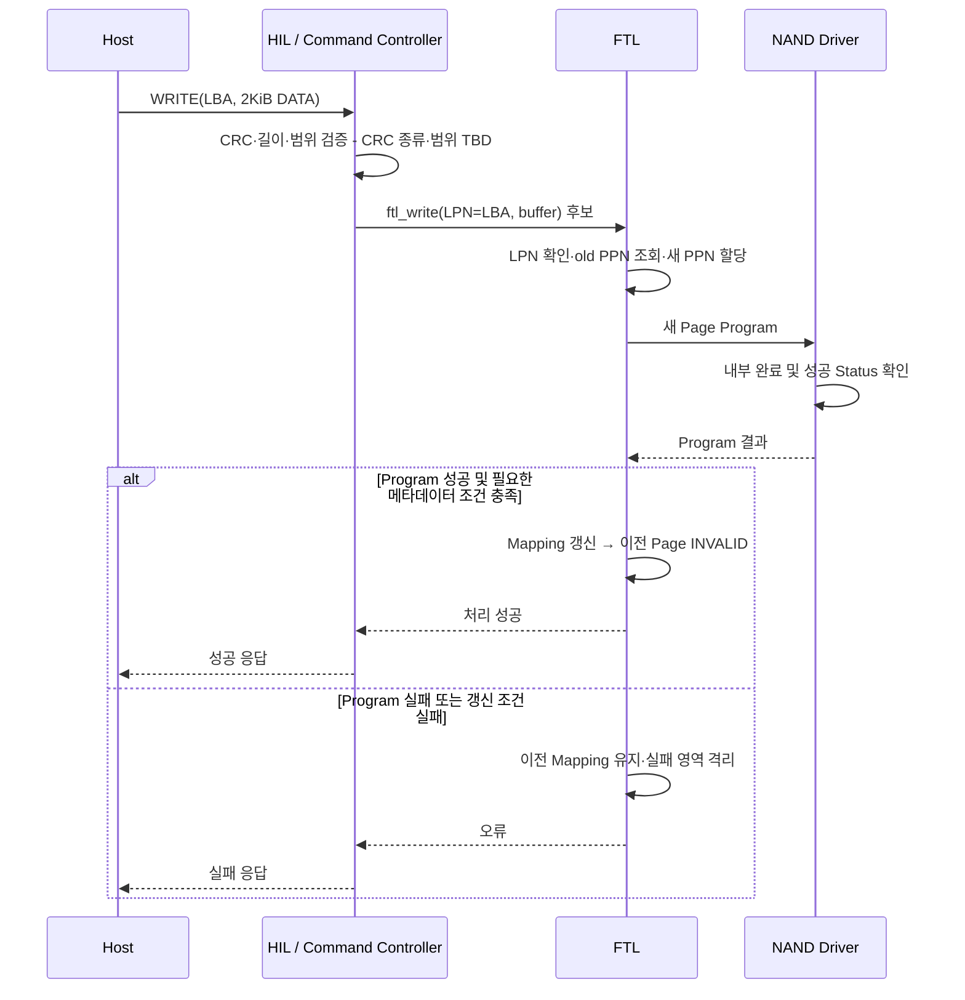
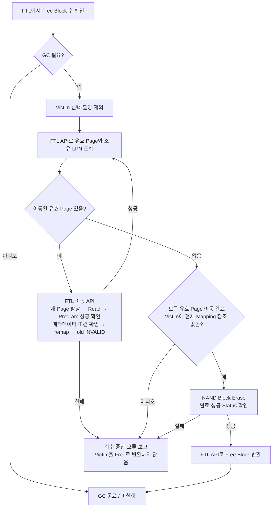

# SOLID FTL / GC API 설계

## 1. 문서 상태와 공통 기준

이 문서는 FTL·GC의 책임 경계와 연동 계약을 정리합니다. 실제 C 코드나 헤더 정의가 아닙니다.

- **확정 기준:** Host LBA = FTL LPN = NAND Data Page = 2KiB, Out-of-place Update, Mapping의 최종 수정 권한은 FTL, GC의 Mapping 변경은 FTL API 사용. Mapping Persistence는 초기 구현 목표이며 완료된 보장이 아닙니다.
- **검토안:** 아래 공통 구조, 상태 모델, 세부 처리 순서와 API 후보.
- **TBD:** 실제 타입·함수 이름·인자·반환형·오류 코드·동시성 제어·저장 형식. API 후보는 검토 후 확정해야 합니다.
- 데이터 단위·하드웨어는 [아키텍처](architecture.md), Host 완료 응답은 [통신 프로토콜](protocol.md)을 따릅니다.

공통 초기 기준은 ST-LINK VCP(UART) Host 경로, 한 번에 요청 1개, READ/WRITE COUNT=1, SRAM Page Buffer 2,048B × 1개입니다. 512B Partial Write는 초기 범위에서 제외합니다. NAND 8개는 연결 목표이며 실제 하드웨어 검증 완료를 뜻하지 않습니다.

## 2. 책임과 공통 구조

### 2.1 FTL 책임

| 책임 | 내용 |
|---|---|
| L2P Mapping | LPN → PPN Mapping Table 소유 |
| Page 할당 | 빈 물리 Page 선택·예약 |
| Page State | Page 상태와 관련 Block 통계 관리 |
| Out-of-place Update | 새 Page Program 후 Mapping 전환 |
| NAND 연동 | NAND Driver API 호출 및 결과 처리 |
| Mapping 갱신 | Host WRITE와 GC 이동의 최종 Mapping 수정 |
| GC 연동 | 공간 회수 요청과 GC 실행 조정 |
| Mapping Persistence | 저장·복원 및 정상 종료 연계 |

### 2.2 GC 책임

| 책임 | 내용 |
|---|---|
| 시작 조건 확인 | Free 자원과 회수 필요성 확인 |
| Victim 선택 | 회수할 Block 선정 |
| 유효 Page 식별 | FTL 조회 API로 현재 유효성 확인 |
| 유효 Page 이동 | FTL 이동 API를 이용해 복사·Mapping 전환 수행 |
| Block 회수 요청 | 이동 완료 후 `ftl_reclaim_block` 호출. Erase·Free 반환·BAD 처리는 FTL이 수행 (2026-11-20 합의) |
| 실패 처리 | 이동·Erase 실패를 보고하고 잘못된 회수를 방지 |

**Mapping Table의 최종 수정 권한은 FTL에 있습니다.** GC는 L2P 배열·Page State·Block 통계를 직접 수정하지 않습니다. 조회 결과와 FTL API를 통해 작업하며, 새 PPN을 임의로 L2P에 대입하지 않습니다.

### 2.3 Mapping 구조

다음은 공통 의미를 표현하는 **검토안**입니다. 메모리 레이아웃과 C 타입을 확정하지 않습니다.

```text
L2P[LPN] → PPN 또는 UNMAPPED

PPN → NAND ID / Block / Page
Page 유효성 판단: 해당 Page를 현재 L2P가 가리키는지 확인
```

| 개념 | 의미 | 표현 / 미정 사항 |
|---|---|---|
| LPN | 2KiB 논리 Page 번호, 현재 Host LBA와 동일 | 정수 폭·타입 TBD |
| PPN | 물리 Page 식별자 | 전체 칩 기준 번호 또는 관리 영역 내 번호 여부 TBD |
| NAND ID | 칩 식별자 | 대상은 향후 8개 칩, 타입·번호 인코딩 TBD |
| Block | 해당 칩 안의 Block | 칩당 1,024개, 타입 TBD |
| Page | 해당 Block 안의 Page | Block당 64개, 타입 TBD |
| UNMAPPED | 논리 Page에 유효 Mapping이 없음 | Sentinel 값 또는 별도 Valid 정보 TBD |
| Page 소유 LPN 조회 | GC가 PPN에서 현재 소유 LPN 확인 | 역방향 테이블, L2P 검색, 메타데이터 등 방식 TBD |

PPN의 비트 필드·직렬화 형식과 UNMAPPED 값은 임의로 정하지 않습니다. GC가 역방향 조회를 필요로 한다고 해서 전체 P2L 테이블을 SRAM에 두는 방식이 확정된 것은 아닙니다.

초기 용량 제안이 채택되면 L2P는 8,192항목, 물리 관리 대상은 12,288 Pages입니다. 8칩의 전체 Raw 용량과 초기 관리 영역은 구분합니다. 상세 메모리 예산은 [아키텍처의 SRAM 검토](architecture.md#8-초기-저장-용량과-sram-예산)를 참조합니다.

| 초기 용량 검토안 | 계산 / 비교 |
|---|---|
| 논리 16MiB / 물리 관리 24MiB | 8,192 LPN / 12,288 PPN, 최종 용량·배치 미확정 |
| 4Byte Mapping Entry 가정 | 8,192 × 4B = 32KiB |
| 2Byte Mapping Entry 가정 | 8,192 × 2B = 16KiB |
| 우선 검토 / 추천안 | 전역 **관리 영역 내 PPN**을 16bit 값으로 표현 |

2Byte Entry는 확정 자료구조가 아닙니다. 12,288개 관리 Page를 표현할 수 있는지와 Invalid PPN용 Sentinel을 분리할 수 있는지 확인하고, PPN → NAND ID / Block / Page 변환 함수를 정의해야 합니다. Sentinel의 실제 값, 변환 함수 이름·원형, 관리 영역의 칩별 배치는 TBD입니다. 16bit로 8칩 전체 Raw 524,288 Pages를 직접 표현할 수는 없으므로 확장 시 재검토합니다.

### 2.4 Page·Block 상태 모델 후보

| Page 상태 후보 | 의미 |
|---|---|
| FREE | Erase된 Block 안에서 아직 사용·예약하지 않은 Page |
| RESERVED | 할당됐지만 Program 또는 Mapping 전환이 완료되지 않은 Page |
| VALID | Program에 성공했고 현재 L2P가 가리키는 Page |
| INVALID | 최신 Mapping에서 제외되어 Block Erase를 기다리는 Page |
| BAD/UNUSABLE | 사용 불가능한 영역. Block 단위 결함 정보를 통해 해당 Page를 제외하는 표현도 검토 |

```text
FREE → RESERVED → VALID → INVALID
          │
          └─ 실패 → 재사용 금지 상태로 분리 (구체적 상태·정책: TBD)

INVALID → FREE: 해당 Block의 Erase 성공 이후에만 가능
```

| Block 관리 정보 후보 | 용도 |
|---|---|
| Free / Open / Closed / GC 대상 상태 | 할당과 Victim 선정 시 구분 |
| Free·Valid·Invalid Page 수 | GC 조건·회수량 산정 |
| Bad / 사용 금지 상태 | 초기 불량 및 운용 중 실패 처리 |
| Metadata / GC 예약 여부 | 일반 할당·Victim 대상과 구분 |

상태 이름·전이의 실제 구현, 카운터 자료형, Erase Count 추적 여부는 TBD입니다. Bad Block은 Block 단위로 관리하며, 해당 Block의 Page를 FREE로 취급하지 않습니다.

검토할 일관성 조건:

- 매핑된 LPN은 최신 PPN 하나를 가리키며, 같은 PPN을 서로 다른 LPN에 중복 할당하지 않습니다.
- INVALID Page는 Block Erase 전까지 새 Program 대상으로 사용하지 않습니다.
- L2P 전환과 Page State·Block 통계 변경은 FTL의 일관된 작업으로 처리합니다.
- Victim, Bad Block, 메타데이터·예약 영역을 일반 Page 할당에서 제외합니다.

## 3. 데이터 처리 흐름 검토안

### 3.1 READ

```text
HIL / Command Controller
→ LPN 및 범위 확인
→ FTL의 L2P 조회
→ PPN 해석
→ NAND Page Read 및 완료·ECC 상태 확인
→ 공유 2KiB Page Buffer
→ HIL 응답 전송 완료
→ Buffer 반환
```

UNMAPPED Page의 읽기 결과를 오류·0 채움 등 무엇으로 정의할지는 TBD입니다. NAND의 Erase 패턴을 Host 읽기 규격으로 그대로 확정하지 않습니다. Correctable / Uncorrectable ECC 상태 처리와 Host 보고 방식도 TBD입니다.

### 3.2 WRITE와 Out-of-place Update



| 단계 | 검토할 계약 |
|---|---|
| 주소·길이 검증 | 오류 입력은 할당·Program 전에 거절 |
| 새 Page 예약 | 기존 VALID Page를 덮어쓰지 않음 |
| Program 실패 | 이전 Mapping 유지, 새 Page는 즉시 FREE로 되돌리지 않음 |
| 메타데이터 조건 확인 | 필요한 LPN·Sequence·Commit 정보의 준비·검증 조건은 TBD. 미충족 시 성공 응답 금지 |
| Mapping 전환 | Program 성공 확인 후 FTL만 수행 |
| 이전 Page 무효화 | 새 Mapping 전환과 상태·통계의 일관성 유지 |
| 완료 응답 | 데이터 Program·Mapping 전환과 영속화 완료 의미를 구분 |

세부 Rollback, 재시도, 실패 Page/Block 격리와 Runtime Bad Block 승격 기준은 TBD입니다. 일반 WRITE 성공을 정상 재시작 복구 보장으로 간주하지 않습니다. FLUSH가 약속하는 영속화 조건과 WRITE의 완료 의미는 [프로토콜의 완료 응답과 영속화](protocol.md#6-완료-응답과-mapping-persistence)에 맞춰 합의합니다.

### 3.3 GC



- 초기 Victim 알고리즘 후보는 **Greedy**이며, 유효 Page 수가 적은 Block을 우선 선택합니다. 같은 지오메트리에서 Invalid Page 수를 이용한 판단도 검토할 수 있으나, Free Page가 섞이면 동등한 기준으로 가정하지 않습니다. 최종 정책과 동률 처리는 TBD입니다.
- 현재 쓰기 중인 Block, Bad Block, 메타데이터·예약 Block은 Victim 제외 대상으로 검토합니다.
- GC 목적지 Page는 Victim 외부에서 확보해야 합니다. 이동에 필요한 여유 Page·Block 수와 임계값은 TBD입니다.
- 일부 Page만 이동한 뒤 실패해도 이미 성공한 Mapping 전환을 임의로 되돌리지 않습니다. 남은 유효 Page가 있는 Victim을 Erase하지 않습니다.
- Erase 실패 Block은 Free Pool에 넣지 않습니다. Bad Block 처리와 후속 상태는 FTL·NAND 간 합의가 필요합니다.
- 메타데이터 저장·복원 방식도 회수된 물리 Page를 최신 데이터로 오인하지 않도록 설계해야 합니다. 강제 전원 차단 복구 보장은 초기 범위에 포함하지 않습니다.

세부 절차의 기준 순서는 다음과 같습니다. 호출 원형은 5절의 후보를 따르며, 실행·버퍼 조정 방식은 TBD입니다.

1. FTL에서 Free Block 수 조회
2. GC 필요 여부 판단
3. Victim Block 선택 및 신규 할당에서 제외
4. FTL API로 유효 Page와 소유 LPN 탐색
5. Victim 외부에 새 Page 할당
6. 기존 Page를 공용 2KiB Buffer로 읽기
7. 새 Page에 Program
8. 내부 Program 완료·성공 및 메타데이터 조건 확인
9. FTL API를 통해 현재 old PPN 확인 및 Mapping 갱신
10. FTL이 기존 Page INVALID 처리
11. 모든 유효 Page 이동 및 Victim에 대한 현재 Mapping 참조가 없음을 확인
12. Victim Erase와 내부 완료·성공 확인
13. FTL API를 통해 Free Block 반환

5~10단계는 유효 Page마다 반복합니다. 외부의 단계별 API와 기존 `ftl_move_page`처럼 FTL 내부에서 묶는 API 중 어떤 구성을 노출할지는 TBD입니다.

### 3.4 GC 실패 처리와 예비 Block 검토안

| 항목 | 검토 정책 / 실패 시 조건 |
|---|---|
| GC 시작 조건 | Free Block 수가 임계값 이하 |
| 임계값 초기 후보 | 2 Blocks. 전역/칩별 집계 기준은 TBD |
| GC 예비 Block | 최소 1개 이상 확보하는 정책 검토. 최종 개수 미확정 |
| Copy Read / ECC 실패 | 해당 Page 이동 중단, 기존 Mapping 유지, 유효 Page가 남은 Victim Erase 금지 |
| Copy Program 실패 | 해당 LPN의 기존 Mapping 유지, 목적지 재사용 방지·격리 정책 적용 |
| Erase 실패 | 해당 Block 사용 중지, Free Pool 반환 금지, 원인 검사·Bad Block 판정 |
| 예비 공간 부족 | 새 WRITE 실패 정책 필요. 오류 코드·실패 시점은 TBD |

예약 개수는 관리 영역, 칩별 공간 배분, Bad Block 및 Victim의 유효 Page 복사에 필요한 여유 공간에 따라 조정합니다. 1개 확보만으로 GC 성공을 보장하지 않습니다.

## 4. 공유 Page Buffer와 실행 순서

**확정 기준:** SRAM의 2,048B Page Buffer 1개를 READ·WRITE가 재사용하고, Host 요청은 한 번에 1개만 처리합니다.

단일 Host 요청만 허용해도 Host 데이터와 GC가 같은 버퍼를 동시에 쓰는 문제는 남습니다. 다음 소유권 계약은 **검토안**입니다.

| 작업 | Buffer 점유 범위 |
|---|---|
| Host READ | NAND Read 시작부터 HIL 응답 데이터 전송 완료까지 |
| Host WRITE | UART 데이터 수신 시작부터 Program·Mapping 처리에서 데이터를 더 이상 쓰지 않을 때까지 |
| GC 이동 | 유효 Page Read부터 목적지 Program·Mapping 처리 완료까지 |
| Persistence | 데이터 버퍼 필요 여부 TBD, 사용 시 다른 소유자와 중복 점유 금지 |

특히 **WRITE Payload 수신 후 같은 버퍼로 GC Read를 수행하면 Host 데이터가 손실됩니다.** 다음 중 어떤 흐름을 사용할지는 TBD입니다.

| 후보 | 전제 / 영향 |
|---|---|
| WRITE 데이터 수신 전에 필요한 GC 완료 | 명령과 데이터 사이의 수신 허가 절차·흐름 제어 검토 필요 |
| 유휴 시점에 GC를 실행하고 쓰기 여유 공간을 선확보 | 충분한 예약 공간과 부족 시 요청 처리 정책 필요 |

**결정 (2026-11-20):** 위 두 후보 대신 GC 전용 Buffer를 분리합니다. HIL 수신 Buffer 2KiB × 2, FTL 내부 GC Buffer 2KiB × 1 (합계 6KiB). WRITE 중 공간이 부족하면 FTL이 즉시 GC를 실행하며 Host 데이터는 HIL Buffer에 보존됩니다. 상세는 [프로토콜 5.3](protocol.md#53-page-buffer-배치-2026-11-20-결정).

## 5. API 후보

아래 이름은 **논의용 후보**입니다. C 선언·시그니처·수치형 오류 코드가 아니며, 인자 폭·포인터 소유권·동기/비동기 방식은 모두 TBD입니다. 역할과 입출력 의미를 먼저 맞춥니다.

### 5.1 Host 경로와 Persistence

| API 후보 | 호출자 → 담당 | 입력 의미 | 출력 / 완료 의미 |
|---|---|---|---|
| `ftl_init` | Command Controller → FTL | NAND 구성, 관리 영역, 메타데이터 | Mapping·할당 상태 복원 결과 |
| `ftl_read` | HIL / Controller → FTL | LPN, 공유 2KiB Buffer | 데이터와 Read·ECC 결과 |
| `ftl_write` | HIL / Controller → FTL | LPN, 공유 2KiB 데이터 | Program·Mapping 전환 결과 |
| `ftl_flush` | Controller → FTL | 정상 종료 / 동기화 요청 | 재시작에 필요한 메타데이터 저장 결과 |

초기화와 새 장치 Format은 구분할 필요가 있습니다. 메타데이터가 없거나 손상됐다는 이유로 자동 Erase·Format하는 정책은 확정하지 않습니다.

### 5.2 GC가 사용하는 FTL 경계

| API 후보 | 입력 의미 | 출력 / 사후 조건 |
|---|---|---|
| `ftl_get_ppn` | LPN | 현재 PPN 또는 UNMAPPED |
| `ftl_get_page_info` | PPN | 상태, 현재 소유 LPN 또는 조회 실패 |
| `ftl_get_block_info` | NAND ID / Block | 통계, Bad·예약·할당 상태 |
| `ftl_allocate_page` | 할당 목적, 제외할 Victim 등 | 예약된 PPN 또는 공간 부족 |
| `ftl_get_valid_pages` | Block, 열거 상태·출력 저장소 등 TBD | 현재 Mapping에서 유효한 (LPN, PPN) 정보 |
| `ftl_remap` | LPN, 예상 old PPN, Program 성공한 new PPN | Mapping 전환과 이전 Page 무효화 결과 |
| `ftl_move_page` | LPN, 예상 원본 PPN, Victim, 공유 Buffer | 복사·Mapping 전환 결과와 새 PPN |
| `ftl_release_block` | Erase에 성공한 Block과 결과 정보 | FTL 상태·통계 갱신 및 Free Pool 반환 |
| `ftl_report_nand_error` | 위치와 NAND 실패 정보 | 사용 금지·Bad Block 처리 결과 |

`ftl_move_page`가 FTL 내부 할당·NAND Read/Program·Mapping 전환을 묶어 수행하는 방식을 후보로 둡니다. 이 경우 GC는 이동을 조정하고, 실제 데이터 접근과 Mapping 수정은 FTL이 수행합니다. `ftl_allocate_page` 등 단계별 API를 GC에 별도로 노출할지, 묶음 API만 사용할지는 TBD입니다.

이전 초안의 `ftl_sync`, `ftl_lookup`, `ftl_alloc_page`는 각각 `ftl_flush`, `ftl_get_ppn`, `ftl_allocate_page`와 같은 역할을 논의한 이름입니다. 병렬 구현 시 두 이름으로 별도 계약을 만들지 않도록 최종 명명은 구현 전에 합의합니다. `ftl_get_valid_pages`의 배열·Iterator·Callback 방식과 Page 소유 LPN 검증 방법도 TBD입니다.

GC가 받는 정보는 조회용입니다. 수정 가능한 L2P 포인터를 반환하지 않습니다. 원본 PPN이 현재 Mapping과 다르면 오래된 조회 결과로 덮어쓰지 않도록 처리해야 하며, 재조회·취소 방식은 TBD입니다.

GC는 NAND Driver를 직접 호출하지 않습니다. Block Erase는 `ftl_reclaim_block`을 통해 FTL이 수행합니다 (2026-11-20 합의, 5.2.1 참조).

#### 5.2.1 FTL ↔ GC 합의 결과 (2026-11-20, 박수민·이규현)

| 항목 | 결정 |
|---|---|
| Block 조회 | `ftl_get_block_info(chip, block, &info)`: 상태·valid 수·invalid 수·erase_count를 복사본으로 반환. FTL이 Block 표를 항상 최신으로 유지 |
| Block 상태 | FREE / OPEN / CLOSED / BAD / RESERVED |
| 상태 전이 | FREE →(할당) OPEN →(다 참) CLOSED →(Victim 선택) RESERVED → FREE(Erase 성공) / BAD(Erase 실패) / CLOSED(이동 실패·회수 거부 시 GC가 되돌림) |
| Free 수 조회 | `ftl_get_free_block_count()`: 전역 FREE Block 수 (OPEN 제외) |
| 유효 Page 이동 | `ftl_gc_move_one(chip, block, &moved)`: 한 Page씩 이동, `moved = 0`이면 남은 유효 Page 없음. GC는 PPN·LPN을 알지 못함 |
| 이동 오류 | `ERR_FTL_SRC_READ`(원본 읽기 실패 → GC가 해당 Victim을 skip 목록에 등록) / `ERR_FTL_DST_PROGRAM`, `ERR_FTL_NO_SPACE`(CLOSED 복귀만) |
| Block 회수 | `ftl_reclaim_block`: Erase 후 FREE 반환, 실패 시 BAD. 유효 Page가 남아 있으면 `ERR_FTL_VALID_REMAINS`로 거부(상태 변경 없음) |
| PPN → LPN | Victim마다 L2P를 1회 훑어 목록 작성, 이동 직전에 L2P가 아직 그 PPN을 가리키는지 재검증 |
| 예비 Block | 마지막 Free Block 1개는 GC 전용 (Host 쓰기는 Free ≥ 2일 때만 새 Block 사용), GC 시작은 Free ≤ 2 |
| Victim 선택 | Greedy: valid 최소 → erase_count 최소 → 번호 최소. CLOSED이고 invalid > 0인 Block만 후보 |
| 주소 | `block`은 칩 내 절대 Block 번호, `FTL_FIRST_BLOCK = 0`. `ppn_t`는 GC 인터페이스에 쓰지 않으므로 공통 헤더로 옮기지 않음 |
| GC Buffer | FTL 내부 2KiB × 1 (`protocol.md` 5.3) |

### 5.3 GC 제어

| API 후보 | 호출자 → 담당 | 입력 의미 | 출력 의미 |
|---|---|---|---|
| `gc_init` | Controller / FTL → GC | FTL 조회·갱신 경계와 정책 설정 | GC 제어 상태 준비 결과 |
| `gc_should_run` | Controller / FTL → GC | FTL Free 자원·상태 | 실행 필요 여부 |
| `gc_select_victim` | GC 내부 | Block 조회 정보, 제외 조건 | Victim 또는 대상 없음 |
| `gc_collect` | Controller / FTL → GC | 실행 목적, Buffer 사용 권한 | 회수 결과 또는 실패 |

이전 초안의 `gc_run`은 `gc_collect`와 같은 역할의 이름 후보입니다. 정확한 원형은 모두 TBD입니다. GC의 동기 호출·상태 머신 여부, 재진입 방지, 중첩 GC 금지 방식과 회수 단위는 TBD입니다. GC 이동 중 목적지 부족으로 GC를 다시 호출하는 순환을 방지해야 합니다.

### 5.4 FTL API별 계약 상세 후보

다음은 함수 선언이 아닌 의미 계약입니다. 인자 순서·타입·반환형·오류 값은 **TBD**입니다. `ftl_remap(lpn, old_ppn, new_ppn)`도 호출 의미만 나타냅니다.

| API 후보 | 역할 | 입력 | 출력 | 성공 조건 | 실패 조건 | Mapping 변경 여부 |
|---|---|---|---|---|---|---|
| `ftl_init(...)` | 초기화·복구 | NAND 구성, 관리 영역, 저장 메타데이터 | 준비 상태·복구 결과 | Mapping·할당 상태를 일관되게 준비 | NAND 오류, 구성 불일치, 복구 불가 | 복구값으로 설정 가능. 자동 Format 정책 TBD |
| `ftl_read(lpn, buffer)` | 논리 Page 읽기 | 유효 LPN, 2KiB 출력 Buffer | 데이터·처리 결과 | 합의한 Read/ECC 조건 충족 | 범위·Buffer 오류, NAND/ECC 실패. UNMAPPED 정책 TBD | 없음 |
| `ftl_write(lpn, buffer)` | Out-of-place Update | LPN, 2KiB 입력 데이터 | 처리 결과 | 새 Page Program·메타데이터 조건·Mapping 전환 성공 | 공간 부족, Program·메타데이터·전환 실패 | 성공 시 변경, 실패한 갱신은 기존 Mapping 유지 |
| `ftl_allocate_page(...)` | 빈 Page 예약 | 할당 목적, 제외 영역 등 TBD | 새 PPN·예약 결과 | 사용 가능한 Page를 중복 없이 예약 | 공간 부족, Bad/예약 영역만 남음 | 없음, 할당 상태만 변경 |
| `ftl_get_ppn(lpn)` | 현재 주소 조회 | LPN | PPN 또는 Invalid PPN, 상태 | 범위 내 LPN 조회 | 범위 오류, 초기화 미완료 | 없음 |
| `ftl_remap(lpn, old_ppn, new_ppn)` | Mapping 전환 | LPN, 예상 기존 PPN, Program 성공한 목적지 | 전환 결과 | 현재 Mapping이 old와 일치하고 new 데이터·메타데이터 조건 충족 | 기존값 불일치, 목적지 미준비, 메타데이터 실패 | FTL이 전환·old INVALID·통계를 일관되게 갱신 |
| `ftl_flush(...)` | 앞선 쓰기·Mapping 영속화 | 선행 작업 순서·저장 문맥 TBD | 영속화 완료 또는 오류 | 앞선 데이터와 복구용 상태가 약속한 조건 충족 | 저장 실패, NAND 오류, 영속화 미구현 | 논리 최신값 변경 목적 없음. 저장 상태 갱신 |

`ftl_get_valid_pages(block, ...)`는 유효 (LPN, PPN)을 조회만 합니다. Block 식별·열거 수명·결과 크기·현재 유효성 재검사와 실패 반환은 TBD이며, 수정 가능한 Mapping Table을 반환하지 않습니다. Program 성공 후 remap 실패한 새 Page는 즉시 FREE로 되돌리지 않습니다.

### 5.5 NAND Driver / Mock NAND 공통 API 후보

실제 NAND Driver와 Mock NAND가 같은 API와 완료·실패 의미를 제공하도록 설계합니다. 아래 원형·주소 타입·반환형은 모두 TBD입니다.

| API 후보 | 입력 의미 | 출력 / 완료 의미 | 주요 실패 조건 |
|---|---|---|---|
| `nand_init(...)` | 칩 구성·Driver 문맥 | 초기화·식별 결과 | 통신·ID·구성 오류 |
| `nand_read_page(...)` | NAND ID, Block/Page, 2KiB 출력 Buffer | 내부 Read 완료·데이터·ECC 결과 | 주소·BUSY Timeout·Read/ECC 오류 |
| `nand_program_page(...)` | NAND ID, Block/Page, 2KiB 입력 Buffer, 메타데이터 전달 방식 TBD | 내부 Program 완료와 성공 Status | Program 실패·Timeout·금지 영역 |
| `nand_erase_block(...)` | NAND ID, Block | 내부 Erase 완료와 성공 Status | Erase 실패·Timeout·Bad Block |
| `nand_get_status(...)` | NAND ID, 상태 조회 문맥 | BUSY·실패·ECC 등 상태 | SPI·상태 해석 오류 |

NAND ID와 물리 Block/Page를 개별 인자·주소 구조체·변환된 Row 중 어떻게 전달할지 TBD입니다. 동기 완료 또는 비동기 시작/Status 조합도 TBD이나, **SPI 전송 완료만으로 Program/Erase 성공을 반환해서는 안 됩니다.** NAND ID 읽기, 초기 Bad Block Marker 조회, Spare 접근은 필요한 기능이며 별도 API 노출·기존 API 통합 여부는 TBD입니다. Mock도 Page Program/Block Erase 제약과 실패 주입을 표현해야 합니다.

## 6. 오류 계약 후보

| 의미상 결과 | 기대 처리 | 미정 사항 |
|---|---|---|
| 잘못된 주소 / 길이 | NAND 작업 전에 실패 전달 | 코드·반환형 TBD |
| UNMAPPED | 합의한 읽기 정책 적용 | 반환 데이터·오류 여부 TBD |
| 공간 부족 / Victim 없음 | 요청 대기 또는 실패 전달 | GC 조건·재시도 정책 TBD |
| NAND Read / ECC 실패 | 데이터 유효성을 확인하고 상위에 전달 | Correctable 처리 정책 TBD |
| Program 실패 | 이전 Mapping 보존, 실패 위치 재사용 방지 | 재시도·Bad Block 정책 TBD |
| Mapping 전환 불일치 | 현재 Mapping 재확인, 잘못된 갱신 방지 | 충돌 결과·재시도 TBD |
| Erase 실패 | Free Pool 반환 금지 | Bad Block·후속 처리 TBD |
| Persistence 실패 | 영속화 완료로 응답하지 않음 | Host 보고·복구 정책 TBD |

## 7. Mapping Persistence와 정상 재시작

**확정 목표:** 정상 종료 후 매핑을 복원하고 파일시스템 재마운트·데이터 일치를 검증합니다.

| 저장·복원 검토 대상 | 이유 |
|---|---|
| L2P 및 UNMAPPED 정보 | 최신 물리 Page 식별 |
| Page·Block 할당 상태 또는 재구성 정보 | 이미 사용한 Page 재할당 방지 |
| Bad Block 및 예약 영역 정보 | 불량·메타데이터 영역 재사용 방지 |
| 지오메트리·관리 영역 식별 | 다른 구성의 메타데이터 오적용 방지 |
| 유효성 검사·완료 판별 정보 | 불완전하거나 손상된 메타데이터 구분 |

**Checkpoint 기반 Mapping Persistence를 초기 방향으로 검토합니다.** 저장 위치, Checkpoint 기록·완료 판별 방식, 보조 Journal 여부, OOB 사용 여부, 형식 버전, 검증 방식, 저장 시점, 부팅 복원 순서는 TBD입니다. L2P만 저장하면 전체 할당 상태가 자동 복원된다고 가정하지 않습니다.

### 7.1 Spare Area 검토

| 저장 후보 | 목적 / 미정 사항 |
|---|---|
| LPN | 물리 Page의 논리 소유자 식별 |
| Sequence Number | 갱신 순서 판별, 폭·증가·Wrap 규칙 TBD |
| 데이터 무결성 정보 | 필요 시 저장, 방식·크기 TBD |
| Commit 관련 메타데이터 | 필요 시 저장, Program 순서·완료 판정 TBD |

**64Byte Spare 전체를 자유롭게 사용할 수 있다고 가정하지 않습니다.** W25N01GV의 내장 ECC와 초기 Bad Block Marker 사용 영역을 실제 부품 Datasheet에서 먼저 확인해야 합니다. 사용 가능한 Offset·길이, ECC 설정, Program 횟수 제약, 메타데이터 기록 순서는 TBD입니다. 초기 Bad Block Marker는 Erase 전에 검사합니다.

### 7.2 FLUSH와 정상 재시작

정상 종료 연동 검토안:

```text
Host 파일시스템 동기화·언마운트
→ 기존 I/O 완료 및 새 I/O 유입 차단 조정
→ FLUSH / ftl_flush 영속화 요청
→ NAND 내부 작업과 메타데이터 저장 성공 확인
→ Host에 영속화 완료 전달
→ 정상 종료
```

FLUSH는 선행 WRITE와 Mapping 메타데이터가 약속한 영속화 조건을 만족한 뒤 성공해야 합니다. 영속화 미구현·실패 시 무조건 성공 처리하지 않습니다. Linux FLUSH/FUA 전달, Checkpoint 세부 기록·오류 처리와 WRITE 응답의 추가 영속성 수준은 TBD입니다. 성공 FLUSH 뒤 STM32 재시작 → Mapping 복구 → 파일시스템 재마운트 → 데이터 일치를 검증합니다. 실제 구현·검증 완료로 표시하지 않으며, 갑작스러운 전원 차단을 포함한 완전한 Crash Consistency는 초기 보장 범위에 포함하지 않습니다.

## 8. 병렬 개발 전 합의할 항목

| 항목 | 합의 대상 |
|---|---|
| 타입과 범위 | LPN·PPN·Block 식별, Sentinel, 관리 영역 |
| 조회 API | 상태·소유 LPN 조회 방식, 복사/참조 수명 |
| 변경 API | 이동·Mapping 전환·Block 반환과 통계 갱신 |
| 오류 API | NAND/ECC/공간 부족/영속화 오류 전달 |
| Buffer 계약 | 소유권, 수신 허가, GC 실행 시점 |
| 정책 | Victim 선정, Free 자원 임계값, 예약 공간 |
| Persistence | 저장·복원 형식, 정상 종료 완료 의미 |
| SRAM 예산 | Mapping·역방향 조회·상태·통계·스택 합산 |

검증 계획에는 같은 LPN 반복 갱신, GC 전후 데이터 일치, Program·Erase 실패 시 Mapping/Free Pool 보존, Buffer 중복 점유 방지, 정상 종료·재시작 후 복원을 포함합니다. 구현과 테스트 결과는 아직 없습니다.

## 9. Mock NAND 테스트 시나리오

실제 NAND 없이 검증할 시나리오입니다. 이번 작업에서는 테스트 코드를 작성하거나 테스트 통과를 주장하지 않습니다. 향후 8칩 모델을 사용할 수 있으나 실제 8칩 하드웨어 검증을 대신하지 않습니다. 초기 512B Partial Write는 제외합니다.

| 시나리오 | 준비 / 동작 | 기대 확인 |
|---|---|---|
| Page Write / Read 일치 | 2KiB 패턴을 LPN에 쓰고 읽기 | 데이터 일치, 유효 PPN 조회 |
| 동일 LPN 재기록 | 같은 LPN에 다른 패턴 기록 | 새 PPN 할당, 최신 데이터 반환 |
| 이전 Page INVALID | 재기록 전후 Page 상태 조회 | 새 Page VALID, 기존 Page INVALID, Erase 전 재사용 금지 |
| Free Page 부족 | 할당 가능한 공간 고갈 | GC 또는 합의한 실패, 기존 Mapping·데이터 보존 |
| GC Victim 선택 | 유효 Page 수가 다른 후보 Block 구성 | Greedy 후보 기준·제외 영역 적용, 동률 규칙은 TBD |
| 유효 Page 이동 | VALID/INVALID가 섞인 Victim 회수 | 유효 데이터만 이동, FTL remap, Erase 성공 후 Free 반환 |
| GC 중 Program 실패 | 복사 목적지 Program 실패 주입 | 해당 LPN의 기존 Mapping 유지, 남은 유효 Page의 Victim Erase 금지 |
| Erase 실패 | Victim 이동 후 Erase 실패 주입 | Block 사용 중지·Free Pool 제외, 이동한 최신 Mapping 유지 |
| Bad Block 제외 | 초기 불량 Marker·금지 영역 구성 | Erase 전 Marker 검사, 할당·Victim·목적지 제외 |
| Mapping 저장·복구 | WRITE·GC → 성공 FLUSH → RAM 상태 소실·재초기화 | Mapping·할당·결함/예약 상태 복구, 데이터 일치 |
| 단일 Buffer와 GC | WRITE 수신 또는 READ 응답 중 GC 요청 | 공용 2KiB Buffer 덮어쓰기 방지 |
| FLUSH 실패 | Checkpoint 실패 또는 영속화 미구현 모사 | 영속화 성공 응답 금지, 오류 전달 |

파일시스템 재마운트는 이후 Linux 통합 검증에서 수행합니다. Mock 저장 매체는 유지하고 RAM 상태만 초기화해 정상 FLUSH 후 복구를 확인하며, 강제 전원 차단 복구 성공을 초기 기대 결과에 포함하지 않습니다.
