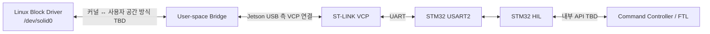
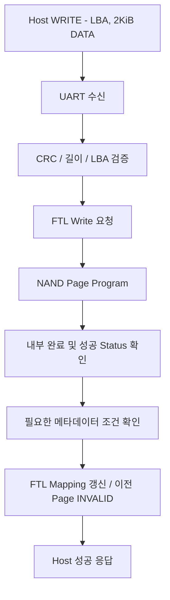
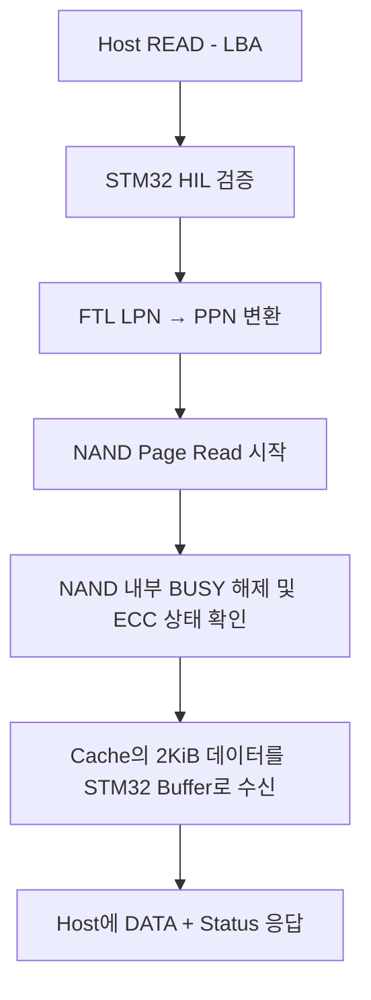

# SOLID Host 통신 프로토콜

## 1. 문서 상태와 범위

이 문서는 Jetson의 User-space Bridge와 STM32F411RE HIL 사이의 통신 기준을 정리합니다.

| 상태 | 내용 |
|---|---|
| 확정 기준 | ST-LINK VCP (UART), LBA 2KiB, READ/WRITE 데이터 2,048B, 한 번에 요청 1개 |
| 확정 기준 | Linux 요청을 Host에서 2KiB 단위로 정렬 검증·분할, 초기 512B Partial Write 미지원 |
| 확정 기준 | Stop-and-Wait, 초기 COUNT=1, 요청 ID로 요청·응답 연결, CRC로 통신 오류 검출 |
| 확정 기준 | 최소 명령 GET_INFO / READ / WRITE / FLUSH, 오류 코드·Timeout 정책 필요 |
| 검토안 | 프레임 구성, 상태 전이, 오류 분류, UART Baud Rate |
| TBD | 프레임 필드 크기·순서·수치, UART 세부 설정, CRC 종류·범위, 재동기화·재시도·영속화 세부 계약 |

현재 문서는 바이트 단위 상호운용 규격을 확정한 상태가 아닙니다. **실제 송수신 구현 전에 4절·8절·10절의 TBD를 합의해야 합니다.**

시스템 구성은 [아키텍처](architecture.md), FTL 호출·Buffer·Persistence 경계는 [FTL / GC API](ftl-gc-api.md)를 참조합니다.

## 2. 연결 경로와 계층 경계



보드의 VCP 지원은 [ST NUCLEO-F411RE 제품 정보](https://www.st.com/en/evaluation-tools/nucleo-f411re.html)를 참조합니다. 초기에는 UART 기반 바이너리 프로토콜을 사용합니다. STM32 USB Device 직접 통신과 USB Bulk는 확장 목표입니다. USART2의 실제 핀·보드 연결 설정은 TBD이며 실측 완료를 뜻하지 않습니다.

| 항목 | 기준 / 결정 상태 |
|---|---|
| Bridge의 Serial 장치 경로 | TBD, 장치 열거 결과를 확인해 선택 |
| Baud Rate | 초기 검토 후보 921,600bps, 채택·안정성 검증 TBD |
| UART Data Bits / Parity / Stop Bits | TBD |
| UART Flow Control | TBD |
| UART Peripheral / 핀 / 보드 연결 설정 | USART2 / 실제 핀·보드 설정 TBD |
| RX 방식 | Polling / Interrupt / DMA 등 TBD |
| Driver–Bridge IPC | 방식, 요청 구조, Buffer 전달·수명, 오류 전달 TBD |

SPI의 8bit Data Frame·Mode 0 초기 권장값은 UART 설정과 별개입니다.

UART는 바이트 스트림이므로 한 번의 수신 호출이 프레임 하나와 일치한다고 가정하지 않습니다. 분할 수신과 연속 수신을 처리할 프레이밍·파싱 계약은 TBD입니다.

## 3. 주소·길이와 요청 분할

### 3.1 논리 주소

| 항목 | 기준 |
|---|---|
| Protocol LBA 단위 | 2KiB |
| FTL LPN | 현재 LBA와 동일 |
| NAND Data Page | FTL LPN과 같은 2KiB |
| Host가 지정하는 주소 | 논리 주소, NAND ID / Block / Page가 아님 |
| 물리 주소 선택 | FTL이 담당, GC·Out-of-place Update에 따라 변경 |
| 논리 용량 | 초기 16MiB 제안, 최종 값 TBD |

Linux 요청 sector 번호는 일반적으로 512B 단위로 다룹니다. 관련 요청 위치·길이 정의는 [Linux block request 정의](https://raw.githubusercontent.com/torvalds/linux/master/include/linux/blk-mq.h)를 참조하며, 구현 API는 대상 Jetson 커널 버전에 맞춰 확인합니다.

```text
시작 sector % 4 = 0
요청 byte length % 2048 = 0
Protocol LBA = 시작 sector / 4
분할 요청 수 = 요청 byte length / 2048
```

Host는 정렬과 용량 범위를 검증하고, 여러 블록 요청을 2KiB 요청으로 나눠 순차 처리합니다. 나눗셈으로 남는 위치·데이터를 버리지 않습니다. 초기 설계에는 부분 쓰기를 위한 Read-Modify-Write를 포함하지 않습니다.

예: sector 8에서 4,096B 요청 → LBA 2, LBA 3 요청을 각각 처리합니다. 16MiB 제안이 채택되면 LBA 범위는 0~8,191이지만, 확정된 노출 용량으로 간주하지 않습니다.

Linux 논리 블록 크기는 2KiB 기준을 반영해야 합니다. 정렬 검증·분할을 Driver와 Bridge 중 어디서 수행할지는 TBD입니다. 범위 검사에는 종료 주소 계산의 정수 Overflow도 고려합니다.

### 3.2 READ/WRITE 데이터 의미

| 동작 | Host → STM32 | STM32 → Host |
|---|---|---|
| READ | LBA를 포함하는 읽기 요청, Page 데이터 송신 불필요 | 성공 시 2,048B 데이터와 실행 결과 |
| WRITE | LBA를 포함하는 쓰기 요청과 2,048B 데이터 | 실행 결과 |

이 표는 데이터의 방향과 의미를 정의합니다. 요청·응답 헤더, 상태, 무결성 정보의 배치와 길이는 TBD입니다. 에러 응답 Payload 형식과 길이도 TBD이며, 실패 READ의 데이터를 정상 데이터로 전달하지 않습니다.

한 READ/WRITE가 논리 Page 1개를 대상으로 하며 초기 COUNT=1입니다. COUNT를 선로에 별도 필드로 둘지와 크기·배치는 TBD입니다. COUNT는 블록 수, DATA_LENGTH는 Byte 수 의미로 구분하며 둘의 표현 방식을 합의해야 합니다.

## 4. 프레임 구조 검토안

아래는 필요한 정보를 검토하기 위한 목록이며, **선로상의 순서·필드 존재 여부·길이를 확정하지 않습니다.**

```text
요청 의미: 명령 + 논리 주소 + 필요 시 2KiB WRITE 데이터
응답 의미: 요청에 대응하는 실행 결과 + 성공 READ의 2KiB 데이터

프레임 후보 요소 (Byte 배치·크기 미확정):
MAGIC | VERSION | COMMAND | REQUEST_ID | LBA | COUNT / DATA_LENGTH | PAYLOAD | CRC
응답 Status 및 ACK/ERROR 표현 방식: TBD
```

| 필드 후보 | 의미 | 요청에서 사용 | 응답에서 사용 | 크기 / 값 / 정책 |
|---|---|---|---|---|
| MAGIC | 프레임 경계 식별 | 사용 후보 | 사용 후보 | 값·Byte 크기·Delimiter/Escaping·동기화 방식 TBD |
| VERSION | 호환성 판별 | 사용 후보 | 사용 후보 | Byte 크기·초기값·불일치 처리 TBD |
| COMMAND | 동작 식별 | 명령 지정 | 명령 대응 또는 응답 타입 TBD | Byte 크기·Opcode 숫자 TBD |
| REQUEST_ID | 현재 요청과 응답 연결 | 요청 식별 | 같은 요청에 대응하는 ID | Byte 크기·증가·재사용·중복 규칙 TBD |
| LBA | 2KiB 논리 주소 | READ/WRITE 대상 | 재전달 여부 TBD | Byte 크기·명령별 필드 존재 여부 TBD |
| COUNT / DATA_LENGTH | 블록 수 / Payload Byte 수 | READ/WRITE COUNT=1, WRITE 데이터 2,048B | READ 성공 데이터 2,048B | 필드 구성·Byte 크기·제어 명령 표현 TBD |
| PAYLOAD | 사용자 데이터·제어 정보 | WRITE는 2,048B, READ 요청에 Page 데이터 없음 | READ 성공은 2,048B, GET_INFO 스키마 TBD | 오류·기타 응답 Payload TBD |
| CRC | 통신 데이터 오류 검출 | CRC 검증 필요 | CRC 검증 필요 | 종류·다항식·초기값·Byte 크기·적용 범위 TBD |
| Status / ACK / ERROR | 실행 성공·실패 | 요청 내 포함 여부 TBD | 결과 표현 필요 | ACK/ERROR 구조·필드 크기·오류 코드 TBD |

다음 사항은 구현 전 합의가 필요합니다.

- 다중 바이트 필드의 Endianness와 직렬화 규칙.
- 요청·응답의 명령별 필드 구성, Header 길이, 최대 전체 프레임 길이.
- 데이터 안에 경계 값이 나타날 때의 처리와 수신 오류 후 재동기화.
- 프레임 길이·명령·LBA 검증을 NAND 실행 이전에 완료하는 절차.
- UART 디버그 로그와 프로토콜 데이터가 섞이지 않도록 할 출력 경로.
- Native C 구조체를 그대로 전송할지 여부를 포함한 Padding·정렬 문제. 현재 C 구조체 전송 규격은 없음.

CRC의 다항식·초기값이나 Magic 값 등을 예시 숫자로 고정하지 않습니다.

## 5. 명령과 처리 순서

### 5.1 최소 명령과 확장 후보

| 명령 이름 | 상태 | 의미 / 미정 사항 |
|---|---|---|
| `GET_INFO` | 최소 명령, Opcode TBD | 장치 정보 조회. 논리 용량·블록 크기·준비 상태 등 응답 필드 TBD |
| `READ` | 최소 명령, Opcode TBD | 지정 LBA의 2KiB 데이터 읽기 |
| `WRITE` | 최소 명령, Opcode TBD | 지정 LBA에 2KiB Out-of-place Update |
| `FLUSH` | 최소 명령, Opcode TBD | 앞선 쓰기와 Mapping 메타데이터의 영속화 요청 |
| `GET_STATS` | 추가 후보 | 통계 조회, 스키마 TBD |
| `DISCARD` / `TRIM` | 확장 후보 | 미사용 논리 영역 알림, 초기 구현 제외 |
| `GET_STATUS` | 기존 초안의 추가 후보 | 준비·오류 조회를 GET_INFO와 분리할지 TBD |

이전 초안의 `SYNC`는 영속화 요청의 명명 후보였습니다. 이 문서에서는 최소 명령 이름을 `FLUSH`로 통일하며 실제 Opcode는 TBD입니다. GET_INFO는 실제 구성된 용량을 제공하도록 설계하고 16MiB 제안값을 확정 값으로 취급하지 않습니다.

NAND ID·Status 확인, Page Program·Block Erase는 초기 NAND Driver 개발 범위입니다. 이를 Host 진단 명령으로 노출할지는 TBD입니다. 일반 블록 READ/WRITE 경로에서 Host가 Raw 물리 주소나 Erase 대상을 지정하는 규격은 확정하지 않습니다.

### 5.2 한 번에 요청 1개 처리

```text
Host: 요청 전송 → 응답 대기 → 응답 검증·완료 → 다음 요청 전송
STM32: 수신 → 검증 → FTL 실행 → 응답 전송 완료 → 다음 요청 처리
```

- 초기에는 Pipeline과 여러 미완료 요청을 지원하지 않습니다.
- Stop-and-Wait: 현재 요청의 응답을 받은 뒤 다음 요청을 전송합니다. 응답의 Request ID와 CRC를 검증합니다.
- 다음 요청 허용 시점과 수신 허가·흐름 제어 방식은 TBD입니다.
- 잘못된 길이·주소·지원하지 않는 명령이 NAND 작업을 유발하지 않도록 합니다.
- 큰 Linux 요청의 완료는 분할된 요청 결과를 모아 처리합니다. 분할 중 일부가 실패하면 이후 전송을 중단하고 Linux에 오류를 보고합니다. 앞서 성공한 WRITE를 되돌리는 전체 요청 원자성은 보장하지 않습니다. 구체적인 Linux 완료·오류 API와 부분 완료 표현은 TBD입니다.

### 5.3 단일 Page Buffer 제약

STM32 SRAM Page Buffer는 초기 **2,048B × 1개**이며 READ·WRITE·GC가 공유합니다.

| 경로 | Buffer 사용 기준 |
|---|---|
| READ | NAND에서 읽은 데이터를 응답 전송이 끝날 때까지 유지 |
| WRITE | 수신한 2KiB를 Program 처리에서 더 이상 필요하지 않을 때까지 유지 |
| GC | 이동 중 Buffer를 Host READ/WRITE와 중복 사용하지 않음 |

WRITE 데이터 수신 후 GC가 같은 Buffer에 데이터를 읽으면 Host 데이터가 덮어써집니다. GC 선실행을 위한 명령/데이터 분리·수신 허가, 또는 유휴 GC와 여유 공간 확보 중 어떤 방식을 사용할지는 TBD입니다. 이는 HIL·FTL·GC가 공동으로 결정해야 하며, 두 번째 Page Buffer를 전제로 해결하지 않습니다.

UART 수신 상태·Header·기타 제어 메모리는 별도 사용이 가능합니다. Timeout이나 수신 오류가 발생해도 진행 중 NAND 작업의 종료를 확인하기 전에 Buffer를 임의 재사용하지 않도록 설계합니다.

### 5.4 WRITE 처리



그림은 성공 경로입니다. 검증·Program·메타데이터·갱신 실패 시 오류를 반환하며 Program 실패 시 기존 Mapping을 유지합니다. **UART 데이터 수신 성공은 NAND 저장 성공을 의미하지 않습니다.**

### 5.5 READ 처리



NAND 내부 Page-to-Cache Read와 SPI Cache 데이터 전송을 구분합니다. UNMAPPED 읽기·ECC 오류 정책은 FTL과 합의해야 하며 실패 데이터를 정상 READ 결과로 전달하지 않습니다.

## 6. 완료 응답과 Mapping Persistence

완료 의미를 다음과 같이 구분합니다. 아래 세부 응답 정책은 검토안입니다.

| 사건 | 의미 | 상위 완료 처리 검토 기준 |
|---|---|---|
| UART 수신 완료 | 요청 바이트 수신 | WRITE 실행 성공을 의미하지 않음 |
| SPI 전송 완료 | NAND로 명령·데이터 전송 | NAND 내부 Program/Erase 완료와 별개 |
| NAND Program 성공 | 내부 완료·Status 성공 확인 | WRITE 완료의 필요 조건 |
| FTL Mapping 전환 | 최신 PPN 반영 | 논리 WRITE 실행 완료의 필요 조건 |
| Mapping 영속화 완료 | 재시작에 필요한 상태 저장 | 정상 종료·재시작 목표와 연동 필요 |

**WRITE 성공을 어느 영속성 수준에서 응답할지는 TBD입니다.** Program·Mapping 전환 완료 응답과 메타데이터 저장 완료 응답을 동일하게 취급하지 않습니다.

| 결정할 정책 | 상태 |
|---|---|
| WRITE마다 메타데이터 영속화 또는 별도 Sync 시 영속화 | TBD |
| Linux FLUSH/FUA를 펌웨어 동기화와 연결하는 방식 | TBD |
| Linux에 노출하는 Write Cache·Flush 지원 특성 | TBD |
| 정상 종료 시 새 I/O 차단·진행 중 요청 완료·Sync 순서 | TBD |
| 재시작 후 메타데이터 복원·READY 확인·장치 사용 허용 | TBD |

정상 종료 검증 흐름의 검토안은 다음과 같습니다.

```text
파일시스템 동기화·언마운트
→ 진행 중 블록 I/O 완료 확인
→ FTL Persistence 완료 요청·성공 확인
→ 정상 종료
→ 재시작·Mapping/할당 상태 복원
→ 준비 상태 확인 후 재마운트·파일 데이터 비교
```

FLUSH의 실제 Opcode와 응답 형식은 정하지 않습니다. 강제 전원 차단 복구는 확장 후보입니다.

## 7. FLUSH와 영속화

**FLUSH는 단순 ACK 명령이 아닙니다.** 앞선 WRITE와 Mapping 메타데이터가 약속한 영속화 조건을 만족해야 성공합니다. `sync` / `umount` 및 그 과정의 최종 FLUSH 성공 확인 → 정상 종료 → STM32 재시작 → Mapping 복구 → 파일시스템 재마운트·데이터 일치가 초기 검증 목표이며 실제 통과 결과가 아닙니다. Host 동기화 중 발생하는 WRITE 뒤에도 필요한 최종 FLUSH가 전달되어야 합니다.

Checkpoint 기반 Mapping Persistence가 초기 검토 방향입니다. Checkpoint 위치·형식·기록 순서·완료 판정·오류 처리는 FTL 설계와 연동해 TBD로 둡니다. **영속화가 미구현이거나 실패했다면 FLUSH를 무조건 성공 처리하지 않습니다.** 지원 불가·영속화 실패의 오류 코드와 Linux 전파 방식은 TBD입니다.

Linux FLUSH/FUA와 캐시 특성을 정확히 연결해야 하며, 미지원 기능을 성공으로 처리하지 않습니다. 성공 FLUSH가 갑작스러운 전원 차단을 포함한 완전한 Crash Consistency를 보장한다는 뜻은 아닙니다.

## 8. 오류·Timeout·재시도 검토

| 오류 분류 후보 | 예 | 처리 방향 / TBD |
|---|---|---|
| Framing / Integrity 오류 | 경계·길이·CRC 불일치 | 실행 전 거절·재동기화, 상세 규칙 TBD |
| 명령·주소 오류 | 미지원 명령, 범위 초과 | Host로 실패 전달, Status·Linux 오류 매핑 TBD |
| 준비 상태 오류 | 초기화·복원 미완료, GC 중 | 대기·거절 및 수신 허가 방식 TBD |
| NAND / ECC 오류 | Read·Program·Erase 실패 | FTL 결과 전달, 수치형 코드 TBD |
| 자원 부족 | Free Page 부족, 회수 대상 없음 | GC·실패 처리 연동 TBD |
| Persistence 오류 | 메타데이터 저장·복원 실패 | 영속화 성공으로 보고하지 않음 |
| 통신 Timeout / 연결 해제 | 프레임 중단, 응답 유실 | 실행 여부 판별·재연결·복원 절차 TBD |

Timeout은 수신, 응답, NAND 내부 작업, GC 소요 시간의 관계를 고려해 정합니다. Baud Rate나 고정 Timeout 값을 임의로 확정하지 않습니다.

**응답 Timeout만으로 WRITE가 실행되지 않았다고 판단할 수 없습니다.** 중복 요청 식별·응답 재전송·자동 재시도 정책은 TBD입니다. Request ID만 추가하면 중복 실행이 자동 방지된다고 가정하지 않습니다.

재연결 시 미완성 프레임과 이전 응답을 새 요청에 연결하지 않도록 해야 합니다. 연결 초기 동기화, 요청 결과 불명 상태 처리, Parser 초기화 시점은 TBD입니다.

## 9. 검증 계획

아래 항목은 향후 검증 대상이며, 실제 검증 완료를 의미하지 않습니다.

| 대상 | 확인할 내용 |
|---|---|
| 주소 변환 | 512B sector→2KiB LBA, 다중 블록 분할, 비정렬·범위 초과 거절 |
| Payload | WRITE 수신과 READ 응답의 2,048B 데이터 일치 |
| Stream 처리 | 분할 수신, 연속 수신, 잘못된 길이·경계·무결성 |
| 요청 직렬화 | 한 번에 요청 1개, 응답 완료 이전 Buffer 재사용 방지 |
| GC 연동 | 수신한 WRITE 데이터 보존, GC 이후 최신 데이터 Read |
| 오류 전파 | NAND/ECC/자원 부족/Persistence 오류의 Host 전달 |
| Timeout | 응답 유실·연결 해제·중복 요청·이전 응답 구분 |
| 정상 재시작 | 동기화·정상 종료 후 Mapping 복원, 재마운트·파일 비교 |

## 10. 구현 전 공동 결정 목록

| 담당 경계 | TBD |
|---|---|
| Linux Driver ↔ Bridge | 커널 버전, IPC, 요청 구조, 정렬·분할 위치, 완료·오류 처리 |
| Bridge ↔ HIL | UART 설정, 프레이밍, 필드 폭·순서·Endianness, Opcode·Status |
| Bridge ↔ HIL | 무결성 검사, 재동기화, Request ID·중복 처리, Timeout |
| HIL ↔ Controller / FTL / GC | 수신 허가·Buffer 소유권, GC 실행 시점, 준비 상태 |
| Host ↔ Persistence | FLUSH 세부 계약, WRITE 영속성, FLUSH/FUA·캐시 특성, 정상 종료 |
| 전체 | 논리 용량 확정·조회 방식, 지원 기능 및 초기화 호환성 확인 |

프레임의 MAGIC 값, Opcode 숫자, 필드별 Byte 크기, Byte Order, CRC 종류·범위, ACK/ERROR 구조, Timeout·Retry 기준, 손상 프레임 복구 방식은 모두 **TBD**입니다.

## 11. 통신 성능 검토

초기 UART Baud Rate 후보는 **921,600bps**입니다. 아래 계산은 **UART 8N1을 가정**한 이론값이며 최종 설정·실측 속도가 아닙니다. 데이터 1Byte에 Start/Stop을 포함해 약 10bit의 전송 시간이 필요합니다.

| Payload | 계산 | 이론적 최소 시간 |
|---|---|---|
| 2KiB | 2,048 × 10 / 921,600 | 약 22.2ms |
| 16MiB | 16 × 1,048,576 × 10 / 921,600 | 약 182초 |

Protocol Header, CRC, 응답, Stop-and-Wait 대기, NAND 처리, 소프트웨어 지연, 파일시스템 오버헤드를 제외한 수치입니다. 실제 ST-LINK VCP 전송 속도와 안정성은 측정이 필요합니다. 향후 NAND 8개 연결 목표가 UART 처리량 향상이나 실제 하드웨어 검증 완료를 뜻하지 않습니다.

## 12. UART 로그

바이너리 Protocol 데이터와 디버깅 문자열이 섞이지 않도록 합니다. 로그용 별도 채널 또는 프레임 내 메시지 타입 구분을 검토하며 채널·타입·우선순위는 TBD입니다. 프로토콜 UART에 프레이밍되지 않은 디버그 문자열을 출력하는 방식을 사용하지 않습니다.
